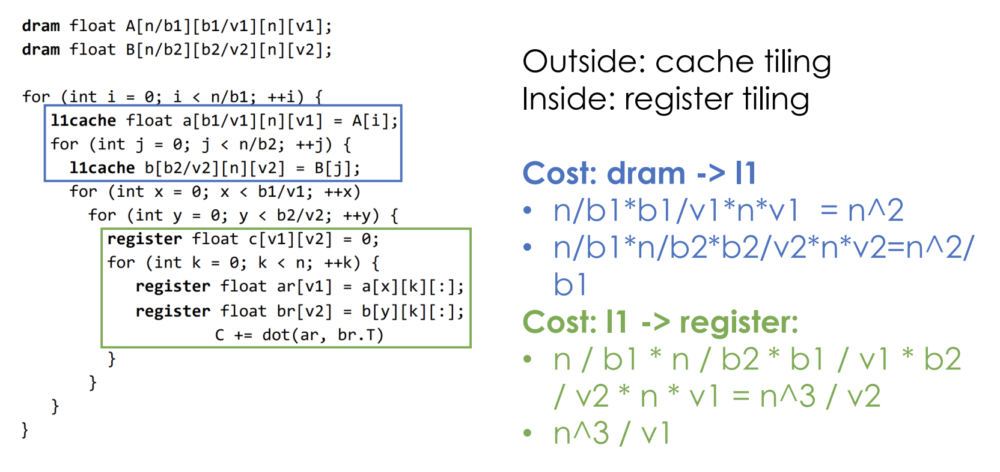
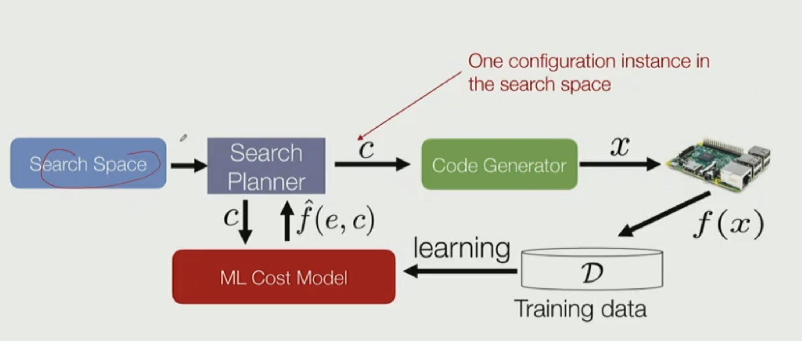
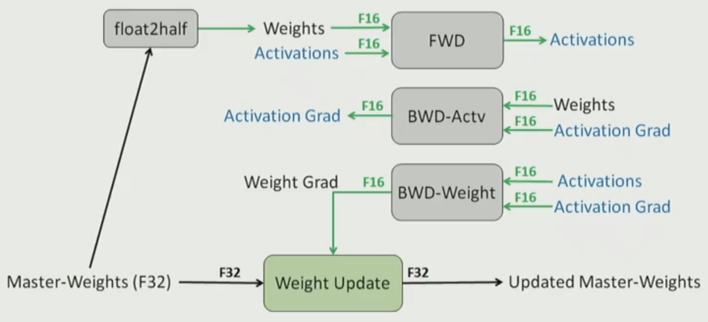
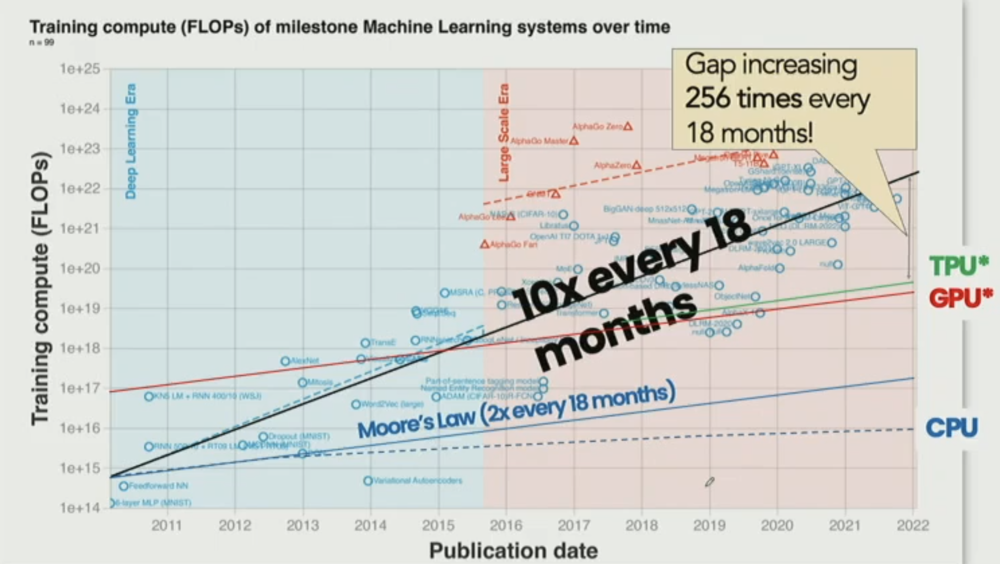
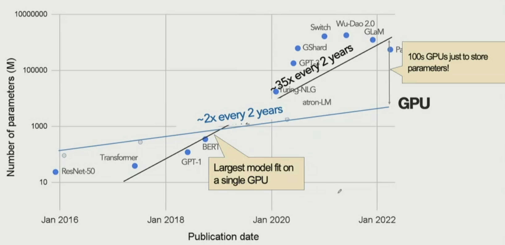
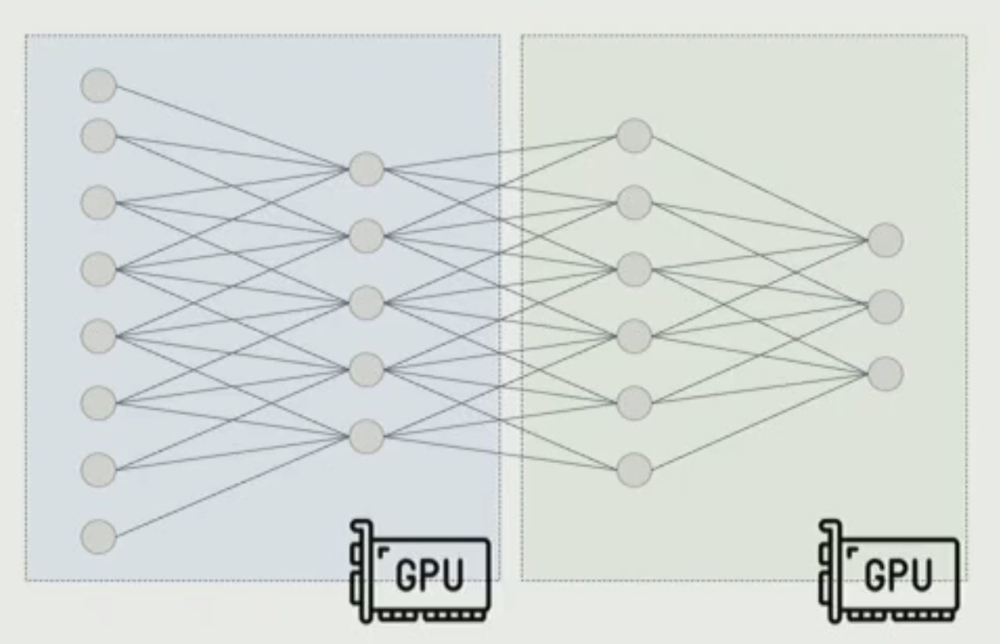
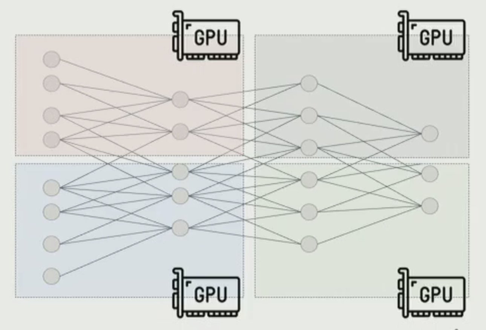
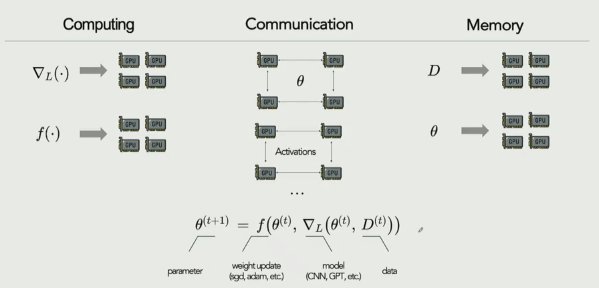
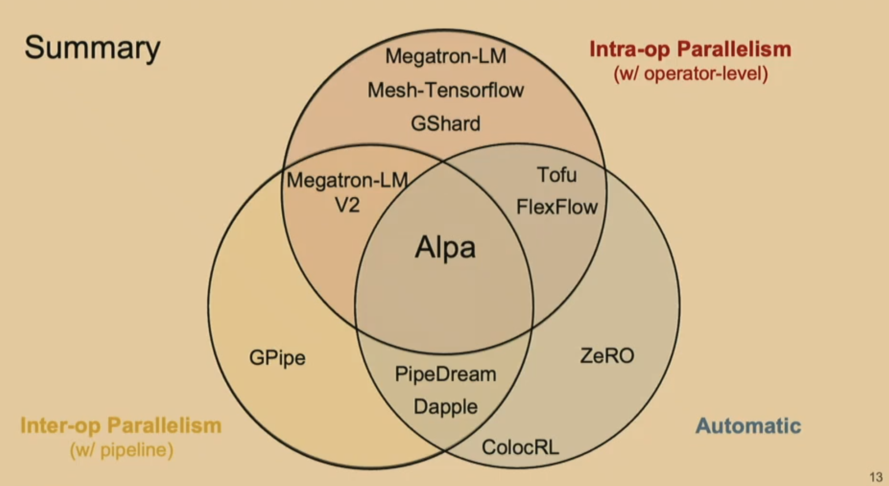
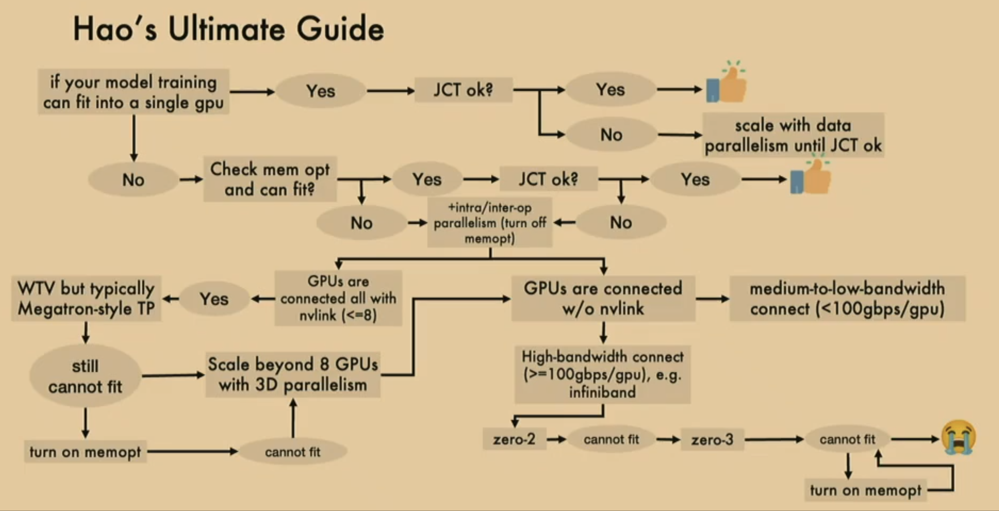

# CSE 234

> https://hao-ai-lab.github.io/cse234-w25/

## Lecture 3

- How to make operators fast
  - Vectorize
  - Data layout
  - Parallelization

- Strides format

```py
A[i0][i1][i2] = A_internal[
  stride_offset
  + i0 * A_strides[0]
  + i1 * A_strides[1]
  + i2 * A_strides[2]
]
```

## Lecture 4

- Why bother store strides?
  - zero-copy - Tensor `view`, `slice`, `transpose`, `boardcast`

- Problem of strides
  - May become not continuous
  - Many operations requires continuous storage


max AI = #ops / #bytes

- MatMul tiling

  

- Moore's Law comes to an end
  - Option 1: Quantum computing
  - Option 2: Specialized hardware
    - GPU
    - TPU
    - B200: fp4 / fp8 tensor core
    - M3: mixing tensor core and normal core

- Sparse
- Quantomizaion - reduce precision


- Apple: 
- Leading startups:
  - Groq

## Lecture 5

- MatMul [m,n]x[n,p], Flops = 2mnp

- Threads, Blocks, Grids, Kernel
- Control flow masking (bubbles)

## Lecture 6

- Kernel tuning
  - Many operators, many devices
  - Manually / compiler

- Compiler
  - Automatically generate optimal configurations and code given users ML code on target hardware

  - Model -> Dataflow graph -> Efficient kernel code -> Machine code
  - How to represent all possibilities (search space)
  - How to search for the optimal one

    Search via learned cost model
    

    - issue: still need experts to write templates


- Notable Compilers:
  - XLA: First compiler for ML, with TensorFlow
  - TVM: For inference
  - Torch 2
  - Modular: By inventor of LLVM

- Triton: simpler than CUDA, more expressive than graph compilers

## Lecture 7

- Why operator fusion improves performance?
  - Reduce I/O
  - Reduce kernel launching

- Fused kernel launching

- Graph substitution
  - Enumerate all patterns of 4 operators

## Lecture 8

- Runtime

- Batch
  - Batch = Mini-batch
  - Micro-batch: smaller than batch

- Goal: max(memory) < available memory

- Memory consumption sources:
  - Model weights
  - Intermediate activation values
  - Optimizer states

- Adam Optimizer states: 3*elements

- Reduce memory
  - Recompute activation on backward (i.e. Checkpointing)
  - Gradient accumulation among mini-batch, then update
  - Swap out to CPU, swap in later (slow)
  - Quantization

## Lecture 9

- FP8
  - Training: more dynamic range: E4M3
  - Inference: more precision: E3M4

- INT4, FP4(E1M2, E2M1, E3M0)

- K-means quantization

- Linear quantization

## Lecture 10

> Guest Lecture by Tianqi Chen

- Web LLM

- Computing, scaling, data

## Lecture 11

- Quantization granularity:
  - Per-tensor: problem: some channels have outlier weights
  - Per-channel
  - Per-group
  - (No quantization)

- Sweetspot: two-level quantization
  - $r = \gamma S_q (q - Z)$
  - $\gamma$ is a floating-point coarse gained scale factor
  - $S_q$ is an integer per-vector scale factor
  - (even multi-level quantization)

- Linear quantization on Activations
  - Dynamic range
    - Should be gathered before deploying the model
    - Using "calibrated" samples

- Mixed precision
  - Different bits for each layer
  - May use a custom model for guided search
  - ICLR 2018: Mixed Precision Training
    - Some layers are more sensitive to dynamic range/precision
      - Normalization, Softmax: sensitive -> more bits
      - Params += sum(grad_t): insensitive
    - A standardized pipeline:
      

- Parallelization
  - 
    

    Model can't fit on a single GPU

  - <div grid grid-cols-2>

    
    

    </div>

  - 

  - Parallelization = Partitioning computing graph on device cluster

  - Inter-operator / Intra-operator Parallelism

  - Raw-partitioned / Column-partitioned / Replicated

  - Data parallelism / Tensor parallelism (Megaton) / Pipeline parallelism

## Lecture 12

- Trade-off:
  - Inter-operator: less communication
  - Intra-operator: less idle time

- MFU = #FLOPs / t / peak FLOPS
  - MFU: Model Flops Utilization
  - #FLOPS: Program's total flops
  - t: Time to finish the program
  - peak FLOPS: GPU constant
  - HFU: Hardware Flops Utilization

- Communication:
  - P2P
  - Collective
    - Broadcast / Reduce
    - Scatter / Gather
    - Allgather / Reduce-scatter
  - Collective can be assembled using many P2P
  - Collective is highly optimized ("xCCL" libraries)

- $\alpha\beta$ model
  - $\alpha + n\beta$, $\beta = \frac{1}{B}$
  - $n$: message size, $B$: bandwidth
  - Small message: $\alpha$ dominates
    - General principles: Low latency
    - "Minimal-spanning tree algorithm"
  - Large message: $n\beta$ dominates
    - General principles: High bandwidth
    - How many rounds of communication does not matter
    - "Ring algorithm"
      - Reduce = Reduce-scatter + Gather
      - Allreduce = Reduce-scatter + Allgather
      - Broadcast = Scatter + Allgather

## Lecture 13

- Parameter Server
- Bounded Consistency
- GPipe schedule / 1Forward1Backward schedule / Interleaved 1F1B / TeraPipe (LM Only) / Chimera

## Lecture 14

> Guest Lecture

## Lecture 15

- Asynchronous pipeline schedules
  - Pros: No pipeline bubbles
  - Cons: Stalled gradient; May store multiple versions of model weights
  - AMPNet: Fully asynchronous. No bubble. Hard to generalize to large datasets
  - Pipedream: Store multiple weight versions. No memory saving compared to single device case
  - Pipedream-2BW: Only store two versions
  
- Imbalanced stages -> Automatic stage partitioning: RL Based / Dynamic Programming

- Intra-op parallelism
  - edge cost: re-partition communication cost
  - ZeRO Optimizer Stage 1/2/3

- Combine inter- and intra-op parallelism

## Lecture 16





## Lecture 17

...

## Lecture 18

> WIP
